<picture>
  <source media="(prefers-color-scheme: dark) and (max-width: 600px)" srcset="./assets/readme-cover-mobile-dark.svg">
  <source media="(prefers-color-scheme: dark)" srcset="./assets/readme-cover-dark.svg">
  <source media="(max-width: 600px)" srcset="./assets/readme-cover-mobile.svg">
  
</picture>

  <a href="https://2retooz270703.github.io/Liber-Primus-27x27-Map-3-Rune-Nodes-Totient-Decryption/"><strong>Open the matrix</strong></a>
  &nbsp; · &nbsp;
  <a href="./Start-reading-here/00-decryption-method.md">Read the method</a>

<a href="./plaintext-i-found/">
<picture>
  <source media="(prefers-color-scheme: dark) and (max-width: 600px)" srcset="./assets/readme-reading-mobile-dark.svg">
  <source media="(prefers-color-scheme: dark)" srcset="./assets/readme-reading-dark.svg">
  <source media="(max-width: 600px)" srcset="./assets/readme-reading-mobile.svg">
  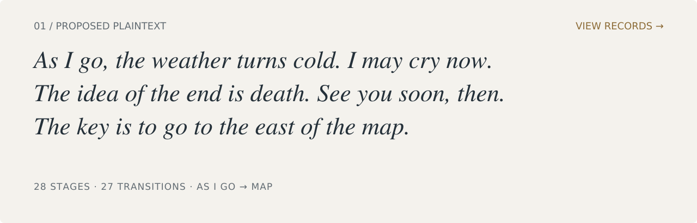
</picture>
</a>

<a href="./Start-reading-here/00-decryption-method.md">
<picture>
  <source media="(prefers-color-scheme: dark) and (max-width: 600px)" srcset="./assets/readme-method-mobile-dark.svg">
  <source media="(prefers-color-scheme: dark)" srcset="./assets/readme-method-dark.svg">
  <source media="(max-width: 600px)" srcset="./assets/readme-method-mobile.svg">
  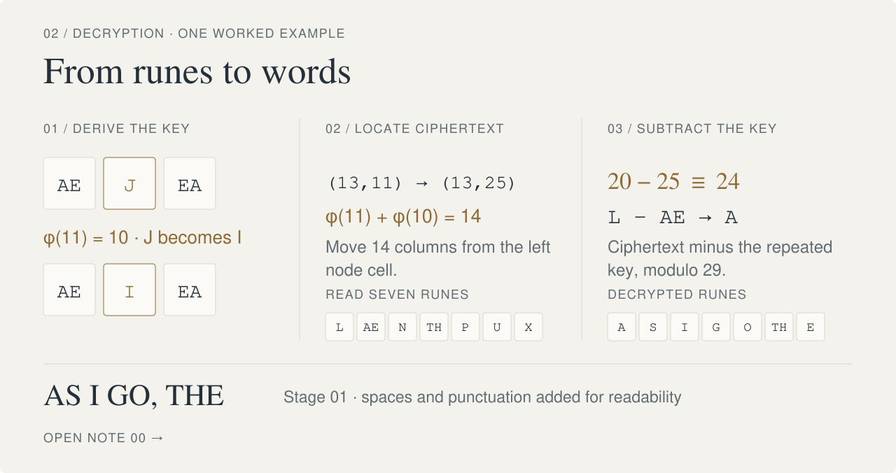
</picture>
</a>

<a href="./Start-reading-here/06-predicting-next-ciphertext-ray-and-mobius-deviation.md">
<picture>
  <source media="(prefers-color-scheme: dark) and (max-width: 600px)" srcset="./assets/readme-geometry-mobile-dark.svg">
  <source media="(prefers-color-scheme: dark)" srcset="./assets/readme-geometry-dark.svg">
  <source media="(max-width: 600px)" srcset="./assets/readme-geometry-mobile.svg">
  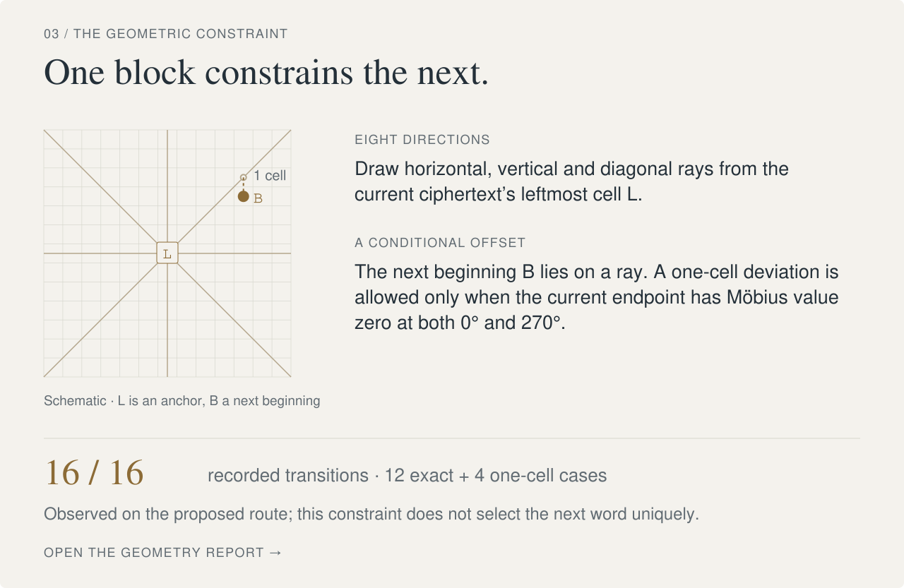
</picture>
</a>

<a href="./Start-reading-here/strongest-plaintext-evidence.md">
<picture>
  <source media="(prefers-color-scheme: dark) and (max-width: 600px)" srcset="./assets/readme-numbers-mobile-dark.svg">
  <source media="(prefers-color-scheme: dark)" srcset="./assets/readme-numbers-dark.svg">
  <source media="(max-width: 600px)" srcset="./assets/readme-numbers-mobile.svg">
  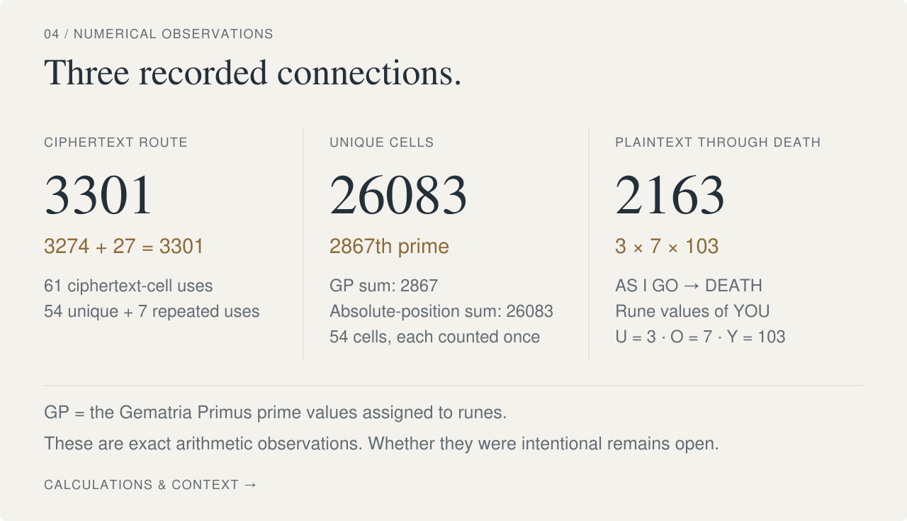
</picture>
</a>

<picture>
  <source media="(prefers-color-scheme: dark) and (max-width: 600px)" srcset="./assets/readme-library-mobile-dark.svg">
  <source media="(prefers-color-scheme: dark)" srcset="./assets/readme-library-dark.svg">
  <source media="(max-width: 600px)" srcset="./assets/readme-library-mobile.svg">
  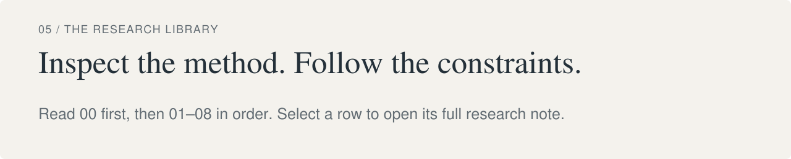
</picture>

<a href="./Start-reading-here/00-decryption-method.md">
<picture>
  <source media="(prefers-color-scheme: dark) and (max-width: 600px)" srcset="./assets/readme-note-00-mobile-dark.svg">
  <source media="(prefers-color-scheme: dark)" srcset="./assets/readme-note-00-dark.svg">
  <source media="(max-width: 600px)" srcset="./assets/readme-note-00-mobile.svg">
  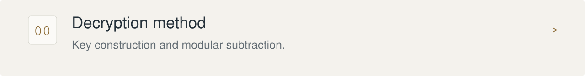
</picture>
</a>

<a href="./Start-reading-here/01-next-key-signature.md">
<picture>
  <source media="(prefers-color-scheme: dark) and (max-width: 600px)" srcset="./assets/readme-note-01-mobile-dark.svg">
  <source media="(prefers-color-scheme: dark)" srcset="./assets/readme-note-01-dark.svg">
  <source media="(max-width: 600px)" srcset="./assets/readme-note-01-mobile.svg">
  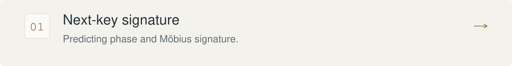
</picture>
</a>

<a href="./Start-reading-here/02-leftmost-cell-and-rotations.md">
<picture>
  <source media="(prefers-color-scheme: dark) and (max-width: 600px)" srcset="./assets/readme-note-02-mobile-dark.svg">
  <source media="(prefers-color-scheme: dark)" srcset="./assets/readme-note-02-dark.svg">
  <source media="(max-width: 600px)" srcset="./assets/readme-note-02-mobile.svg">
  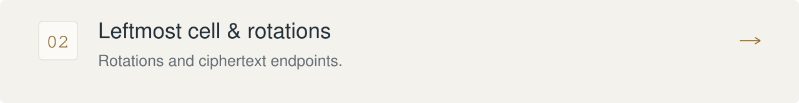
</picture>
</a>

<a href="./Start-reading-here/03-predicting-axis-and-reading-direction.md">
<picture>
  <source media="(prefers-color-scheme: dark) and (max-width: 600px)" srcset="./assets/readme-note-03-mobile-dark.svg">
  <source media="(prefers-color-scheme: dark)" srcset="./assets/readme-note-03-dark.svg">
  <source media="(max-width: 600px)" srcset="./assets/readme-note-03-mobile.svg">
  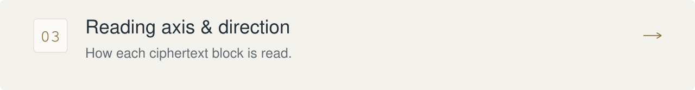
</picture>
</a>

<a href="./Start-reading-here/04-predicting-next-key-center-parity.md">
<picture>
  <source media="(prefers-color-scheme: dark) and (max-width: 600px)" srcset="./assets/readme-note-04-mobile-dark.svg">
  <source media="(prefers-color-scheme: dark)" srcset="./assets/readme-note-04-dark.svg">
  <source media="(max-width: 600px)" srcset="./assets/readme-note-04-mobile.svg">
  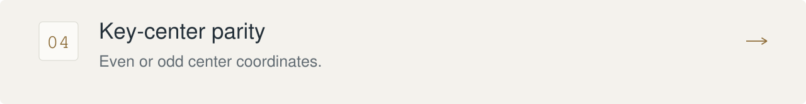
</picture>
</a>

<a href="./Start-reading-here/05-predicting-next-ciphertext-row-parity.md">
<picture>
  <source media="(prefers-color-scheme: dark) and (max-width: 600px)" srcset="./assets/readme-note-05-mobile-dark.svg">
  <source media="(prefers-color-scheme: dark)" srcset="./assets/readme-note-05-dark.svg">
  <source media="(max-width: 600px)" srcset="./assets/readme-note-05-mobile.svg">
  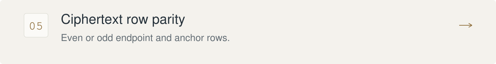
</picture>
</a>

<a href="./Start-reading-here/06-predicting-next-ciphertext-ray-and-mobius-deviation.md">
<picture>
  <source media="(prefers-color-scheme: dark) and (max-width: 600px)" srcset="./assets/readme-note-06-mobile-dark.svg">
  <source media="(prefers-color-scheme: dark)" srcset="./assets/readme-note-06-dark.svg">
  <source media="(max-width: 600px)" srcset="./assets/readme-note-06-mobile.svg">
  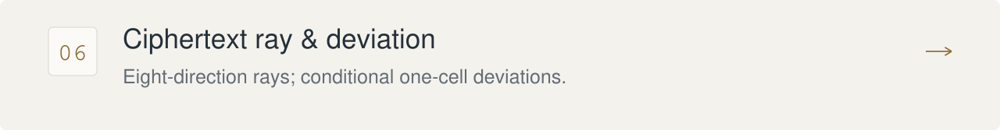
</picture>
</a>

<picture>
  <source media="(prefers-color-scheme: dark) and (max-width: 600px)" srcset="./assets/readme-outlook-mobile-dark.svg">
  <source media="(prefers-color-scheme: dark)" srcset="./assets/readme-outlook-dark.svg">
  <source media="(max-width: 600px)" srcset="./assets/readme-outlook-mobile.svg">
  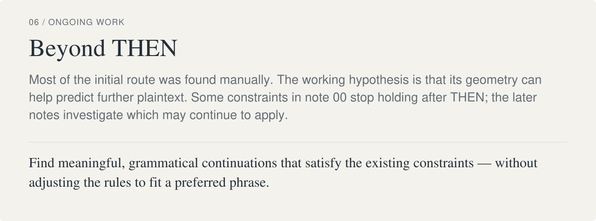
</picture>
