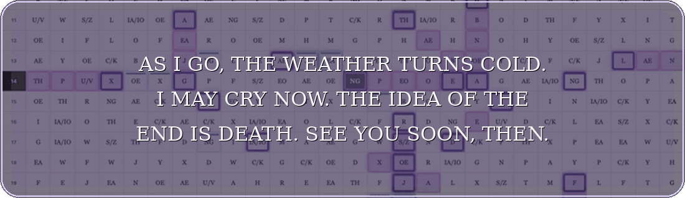
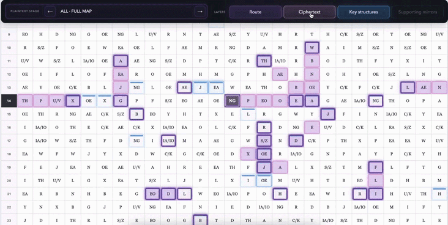

<!-- AUTO-PLAINTEXT:START -->

  

<!-- AUTO-PLAINTEXT:END -->

Plaintext.

---

  

Map.

---

#### 01. [Discovered Deterministic Rules →](./Discovered-Deterministic-Rules/)

**The most important part of my current research.**

This folder documents mathematical rules discovered within the plaintext route, including methods for predicting the next decryption key's phase and its complete Möbius signature.

The latest combined prediction method reproduces all 16 known consecutive key-signature transitions, including the rarest signatures, using the geometry of the matrix and the Möbius function.

These are reproducible results on the known route, with predictions beyond it still awaiting independent verification.

#### 02. [Plaintext I Found →](./plaintext-i-found/)

The proposed plaintext recovered from pages 0–2, documented step by step.

Each file contains the ciphertext coordinates, three-rune key, mathematical transformations, and modular calculations that produce the corresponding plaintext.

#### 03. [Decryption Rules & Supporting Evidence →](./rules/)

A detailed explanation of the underlying decryption method, including:

- How three-rune keys are constructed and applied.
- How the algorithm navigates the 27×27 matrix.
- How mirrored rune structures are used.
- The strongest mathematical evidence supporting the proposed plaintext.
