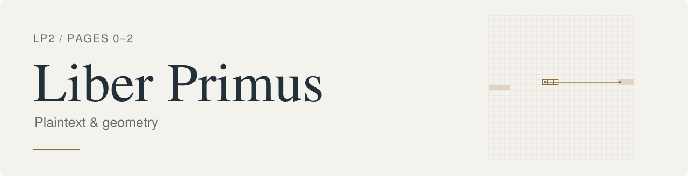

<picture>
  <source media="(prefers-color-scheme: dark) and (max-width: 600px)" srcset="./assets/readme-cover-mobile-dark.svg">
  <source media="(prefers-color-scheme: dark)" srcset="./assets/readme-cover-dark.svg">
  <source media="(max-width: 600px)" srcset="./assets/readme-cover-mobile.svg">
  
</picture>

  <a href="https://2retooz270703.github.io/Liber-Primus-27x27-Map-3-Rune-Nodes-Totient-Decryption/"><strong>Open the matrix</strong></a>
  &nbsp; · &nbsp;
  <a href="./Start-reading-here/00-decryption-method.md">Read the method</a>

Research into a proposed plaintext reconstruction of pages 0–2 of Cicada 3301's *Liber Primus*, using a **27 × 27 rune matrix**, three-rune keys, and geometric constraints.

## Proposed reading

> As I go, the weather turns cold.  
> I may cry now.  
> The idea of the end is death.  
> See you soon, then.

**Recorded route:** [17 stages](./plaintext-i-found/), from **AS I GO** to **THEN**.  
**Proposed continuation:** *The key is to go…*

## Research notes

Begin with **00** for key construction and modular subtraction. Notes **01–06** examine constraints on subsequent keys and ciphertext positions.

| Document | Subject |
| --- | --- |
| [00 · Decryption method](./Start-reading-here/00-decryption-method.md) | Key construction and modular subtraction. |
| [01 · Next-key signature](./Start-reading-here/01-next-key-signature.md) | Predicting phase and Möbius signature. |
| [02 · Leftmost cell & rotations](./Start-reading-here/02-leftmost-cell-and-rotations.md) | Rotations and ciphertext endpoints. |
| [03 · Reading axis & direction](./Start-reading-here/03-predicting-axis-and-reading-direction.md) | How each ciphertext block is read. |
| [04 · Key-center parity](./Start-reading-here/04-predicting-next-key-center-parity.md) | Even or odd center coordinates. |
| [05 · Ciphertext row parity](./Start-reading-here/05-predicting-next-ciphertext-row-parity.md) | Even or odd endpoint and anchor rows. |
| [06 · Ciphertext ray & deviation](./Start-reading-here/06-predicting-next-ciphertext-ray-and-mobius-deviation.md) | Eight-direction rays; conditional one-cell deviations. |

## Selected observations

**GP** refers to the Gematria Primus prime values assigned to the runes.

- **3274 + 27 = 3301** — the ciphertext GP total across the first 17 stages, plus the matrix's side length.
- **26083 is the 2867th prime** — the absolute-position sum and GP sum of the 54 unique ciphertext cells used in those stages.
- **2163 = 3 × 7 × 103** — the plaintext GP sum through **DEATH** factors into the rune values of **YOU**: U = 3, O = 7, Y = 103.

Counting details

The total **3274** counts **61 ciphertext-cell uses**: 54 unique cells and 7 repeated uses. The totals **2867** and **26083** count each of those 54 cells once. The plaintext total **2163** covers the passage from **AS I GO** through **DEATH**.

The **[evidence report](./Start-reading-here/strongest-plaintext-evidence.md)** gives the calculations and context, including a possible connection to Cicada's 2016 message. Whether these relationships were intentional remains an open question.

## Ongoing work

Most of the initial route was found manually. The working hypothesis is that its geometry can help predict further plaintext. Some constraints in note 00 stop holding after **THEN**; the later notes investigate which may continue to apply.

The goal is to find meaningful, grammatical continuations that satisfy the existing constraints without adjusting the rules to fit a preferred phrase.
